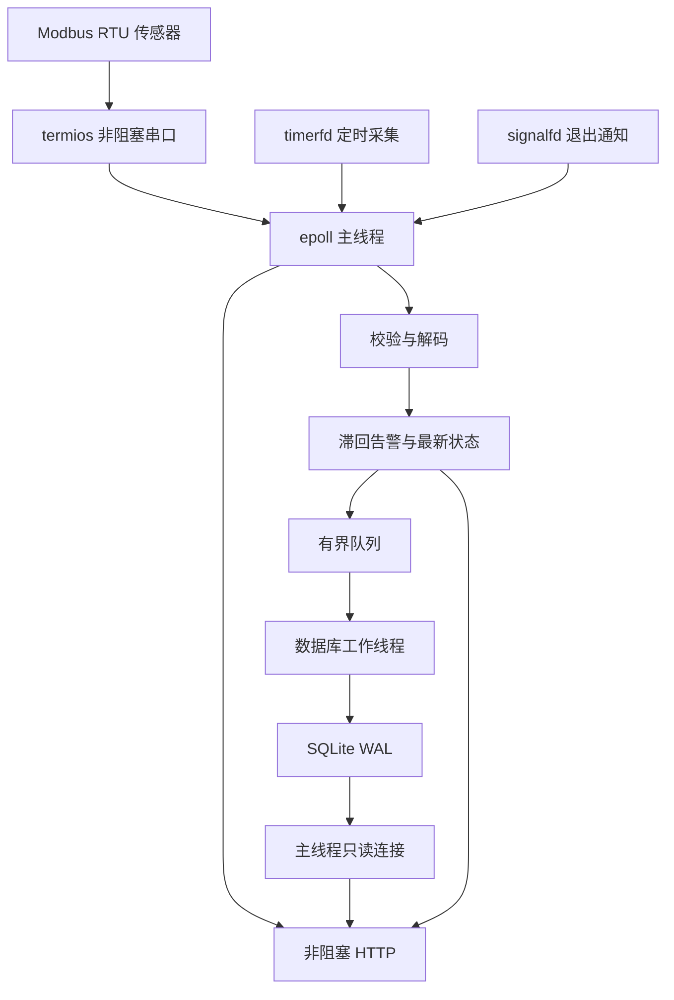

# 架构与设计

## 数据路径

主线程拥有串口、Modbus 解码器、告警状态和 HTTP 客户端。数据库线程拥有写连接；主线程只使用自己的读连接。两个 SQLite 连接都采用 `NOMUTEX`，依靠明确的线程所有权使用。跨线程只共享有界队列和原子计数，不跨线程操作同一个 SQLite 连接。

## 事件循环

选择 level-triggered epoll 方便理解和控制每轮工作量。串口每次最多读取 16 × 256 字节，监听 socket 每轮最多接受 16 个连接。HTTP 每个连接只处理一个 GET 后关闭，遇到 `EAGAIN` 返回事件循环，发送通过 `EPOLLOUT` 继续。请求头最多 4096 字节；连接容量 32，超过容量直接关闭新连接；接收和发送阶段各有 2 秒期限。

`timerfd` 每 20 ms 唤醒，用 monotonic clock 计算采集间隔、超时、重连和过期连接。积压的 timer ticks 会合并读取，不为错过的采集时刻补发一串请求。数据记录使用 Unix 毫秒时间戳，排序使用自增 id，因此系统校时不会打乱历史插入顺序。

启动 worker 之前屏蔽 SIGINT/SIGTERM，再由主线程的 `signalfd` 消费。退出时停止采集、关闭队列、排空已接收任务并 join 工作线程。SIGKILL、设备断电及 systemd 超时强杀无法排空内存队列。

## RTU 请求状态

一个从站最多一个未完成请求。请求固定为读取两个输入寄存器；收到合法响应后更新业务状态，收到异常帧只计数；CRC 错误或越界数值不产生采样。响应超时清除部分帧和待发送状态，连续三次超时关闭串口，按 `reconnect_ms` 尝试重新打开。`EPOLLHUP/ERR` 同样进入重连。

每轮请求前清空输入缓冲区，避免上次残帧污染。RTU 没有事务编号，迟到且格式相同的响应无法严格与下一次同类请求区分；设备最大响应时间、串口延迟和轮询周期必须在现场确认。此实现没有为多个从站设计总线仲裁，也没有实现手动 RS485 收发方向控制。使用适配器的自动方向控制。

## 告警

以默认阈值为例：温度 ≥30°C 进入告警；进入后温度必须 ≤28°C 才恢复。29°C 不引起反复切换。启动时从最近一条持久化样本恢复告警状态；首次新采样前 `latest` 为空且健康检查为 503。

数据库线程按“上一个成功提交的告警状态”判断是否记录事件。采样和告警事件在同一事务中提交。它可避免队列丢弃某一个转折样本后，后续仍处于告警状态却再也不记录进入事件；如果整个高温过程都发生在丢弃区间，仍可能没有可持久化的告警事件。

## 持久化与背压

生产者不等数据库。队列满时丢弃新样本的**存储任务**，最新状态和告警计算继续更新，`storage_dropped` 累加。容量限制队列元素数，HTTP 客户端和串口解码缓存也有边界。

写线程为每个样本开启事务，在一个提交中完成样本、可能的事件及行数清理。SQLite 设置 WAL、`synchronous=FULL`、自动 checkpoint 256 页。已提交记录的掉电持久性取决于 SQLite、操作系统、文件系统和存储设备是否正确执行同步；不能替代真实断电测试。读连接 busy timeout 50 ms，写连接 200 ms。历史 SQL 在主线程执行，因此它并非严格实时系统，繁忙存储仍可能给串口响应带来延迟。

样本和事件分别保留最多 `max_rows` 行。删除由 id 范围控制；删除的数据库页可能留在文件中供后续复用，不会立即归还磁盘。事件的 `sample_id` 为追溯信息，不设外键，样本过期后事件仍可保留。告警表也受自身行数上限控制。

写入错误会 rollback 并增加 `storage_errors`，这个任务不自动重试。下一任务成功后 `storage_ok` 恢复。正常退出码 0；本次运行发生过写入错误则退出码 2；配置/启动异常为 1。历史丢弃计数不会因恢复而清零；进程重启后运行计数重置。

数据库旁创建 `.lock` 文件并 `flock`，同一路径的第二个网关进程启动失败。锁文件可以留在磁盘，锁本身随进程释放。该约束依赖所有实例使用同一个规范化路径和本地文件系统；不要用符号链接/不同路径别名绕过实例管理，不支持把数据库放在 NFS 上。

## 工程取舍

- 手写的 HTTP 实现刻意限制到只读 GET、单请求连接。生产环境需要完整 HTTP 特性时应替换为经过维护的服务器库，而不是逐项扩展解析器。
- 使用 C++ RAII 管理 fd、prepared statement 和线程生命周期，资源清理不依赖手动 goto 路径。
- 没有硬实时、看门狗喂狗、设备控制或安全联锁逻辑。监测失败会体现在状态与日志中，不代替专用保护装置。

参考：[Linux epoll 手册](https://man7.org/linux/man-pages/man7/epoll.7.html)、[SQLite WAL](https://www.sqlite.org/wal.html)、[SQLite 同步级别](https://www.sqlite.org/pragma.html#pragma_synchronous)。
